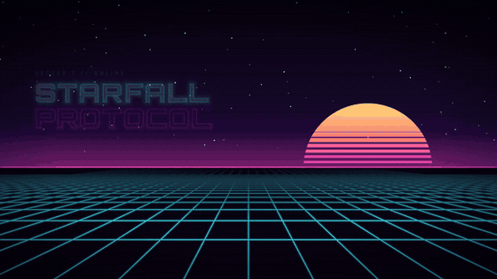

# Game Menu Kit Lite for Godot 4

A free, animated **main menu and options menu** for Godot 4.2+. MIT license.

- **Neon style**: animated synthwave background, glowing title, animated buttons and panels.
- **Main menu**: New Game, Options, Quit with confirmation and a goodbye screen.
- **Options**: Video and Audio tabs, applied live and saved automatically. Add your own settings in one line.
- Soft interface sounds generated by code, mouse / keyboard / gamepad navigation.
- 100% typed GDScript, no image or audio files. English UI with built-in French.

## Install

Copy `addons/game_menu_kit/` into your project, then enable **Game Menu Kit Lite** in
**Project > Project Settings > Plugins**. Open `addons/game_menu_kit/demo/demo.tscn` and press **F6** to try it.

Full documentation: [addons/game_menu_kit/README.md](addons/game_menu_kit/README.md) (French: `README.fr.md`).

## Want more?

**Game Menu Kit PRO** adds 3 more styles (Grimoire, Pop, Glass), save slots with screenshots,
Continue / Load Game, a pause menu, a loading screen, key rebinding and 4 more options tabs:
https://exiforever.itch.io/game-menu-kit-pro

## License

MIT, see `LICENSE`. Fonts: SIL Open Font License (see `addons/game_menu_kit/fonts/`).
